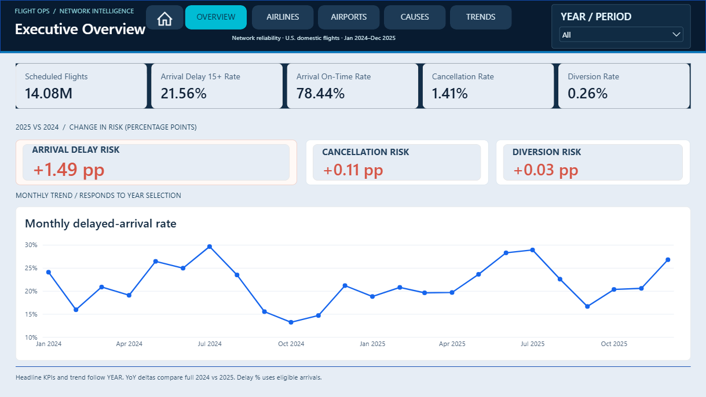
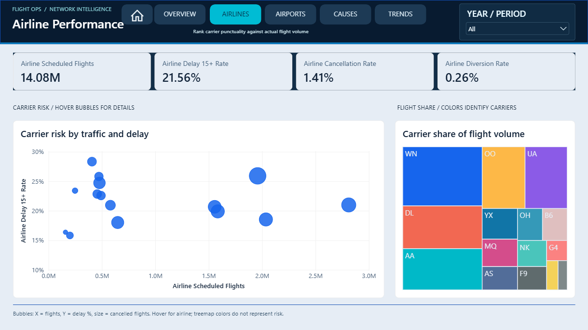
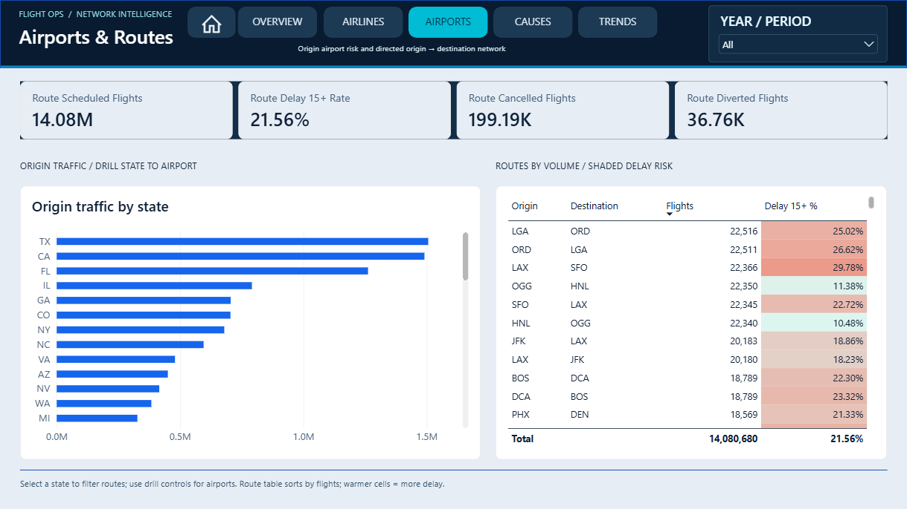
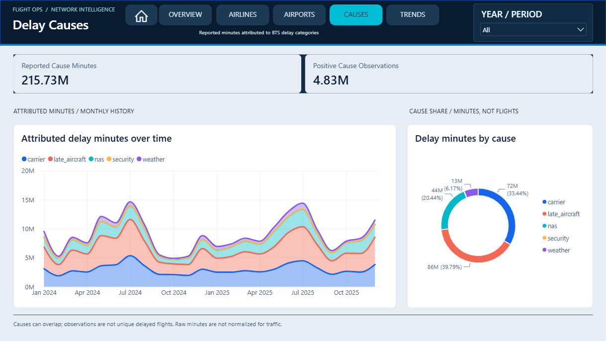
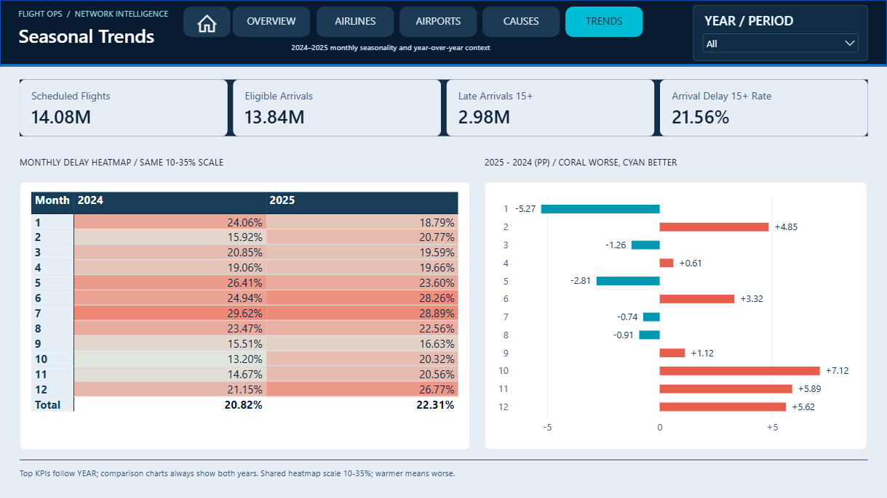
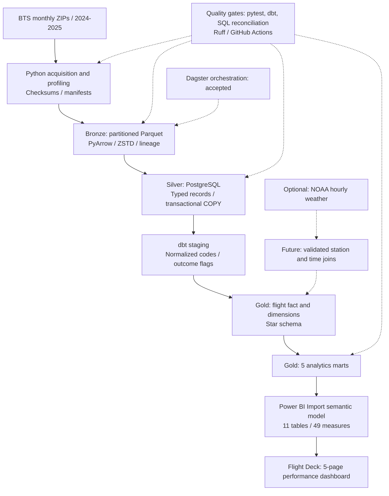

# Flight Operations Intelligence

**End-to-end aviation data engineering and analytics platform**

[](https://github.com/thaquan/Flight_Operations_Intelligence/actions/workflows/ci.yml)
[](https://github.com/thaquan/Flight_Operations_Intelligence/actions/workflows/orchestration.yml)


A reproducible, local-first platform that transforms two years of official U.S. Department of Transportation flight records into a validated PostgreSQL warehouse, business-ready analytics marts and an interactive Power BI report. This Data Engineering / Analytics portfolio project emphasizes source lineage, reliable KPI definitions, repeatable processing and evidence-based operational insights.

**Status:** Phases 1-4 and the five-page Flight Performance dashboard (Phase 5) are complete at the [accepted baseline 93cf3dd](https://github.com/thaquan/Flight_Operations_Intelligence/commit/93cf3ddd00691337e5204cc5b49aaad33b748b32). Phase 7: Dagster orchestration is complete for the local-first historical scope ([M7.1-M7.5 acceptance](docs/phase7/acceptance.md)). Phase 8 is next. NOAA enrichment and a separate risk dashboard are deferred.

[Dashboard](#power-bi-dashboard) | [Architecture](#system-architecture) | [Insights](#key-business-insights) | [Getting started](#getting-started) | [Roadmap](#roadmap)

## Project at a glance

| Dataset & engineering | Analytics & quality |
| --- | --- |
| **14,080,680** scheduled flights | **5** interactive report pages |
| **24** monthly BTS extracts (2024-2025) | **11** semantic tables, **11** relationships |
| **15** reporting carriers, **358** airports (excluding Unknown) | **49** DAX measures |
| **5** Gold analytics marts | **103** Python tests passed at acceptance |
| **445 MB** Bronze Parquet (decimal MB) | **65** dbt data tests passed at Phase 4 |

Evidence: [dataset validation](docs/phase1/2024_2025/phase1_validation.md), [star schema](docs/phase3/m34_validation.md), [Bronze benchmark](docs/phase2/performance_benchmark.md) and [BI acceptance](docs/phase5/m55_acceptance.md).

## Business objectives

- Measure network reliability: late arrivals, cancellations and diversions.
- Identify carrier, airport, directed-route and seasonal performance patterns.
- Compare operational exposure (flight volume) against delay rates and examine the time trend and composition of reported delay causes.
- Establish an analytical foundation for future operational risk prioritization and weather analysis, without claiming causality or real-time prediction.

## Power BI dashboard

**Flight Deck | Flight Performance (Phase 5)**

Open [`powerbi/FlightOperations.pbip`](powerbi/FlightOperations.pbip), the single canonical project, in Power BI Desktop. The report imports PostgreSQL Gold marts.

| Report page | Analytical purpose | Interaction / visualization |
| --- | --- | --- |
| Executive Overview | Network reliability | Monthly trend, headline KPIs, fixed YoY delta strip |
| Airline Performance | Carrier exposure versus reliability | Volume/delay scatter with cancellation-sized bubbles; traffic-share treemap |
| Airports & Routes | Origin airport and corridor performance | State-to-airport drill; linked directed-route table |
| Delay Causes | Reported cause minutes over time and by category | Monthly stacked area and share donut |
| Seasonal Trends | Improving or worsening months | Two-year heatmap and signed percentage-point bars |

All five navigation tabs and Home were tested using actual Ctrl+click actions in Desktop Edit mode. YEAR / PERIOD selection synchronizes across pages. Headline KPIs follow the filter; fixed 2024-versus-2025 comparisons deliberately retain both years. Native drill controls and cross-filtering were also verified.

### Dashboard showcase

Actual Power BI Desktop report canvases captured on 24 November 2026 with YEAR / PERIOD set to All (2024-2025). The screenshots are cropped to the report canvas; application chrome and account details are excluded.

**Executive Overview**

[](docs/phase5/screenshots/01-executive-overview.png)

| Airline Performance | Airports & Routes |
| --- | --- |
| [](docs/phase5/screenshots/02-airline-performance.png) | [](docs/phase5/screenshots/03-airports-routes.png) |
| **Delay Causes** | **Seasonal Trends** |
| [](docs/phase5/screenshots/04-delay-causes.png) | [](docs/phase5/screenshots/05-seasonal-trends.png) |

Click any screenshot to view it at full size. See the [report guide](docs/phase5/README.md) and [acceptance report](docs/phase5/m55_acceptance.md) for the interaction and reconciliation evidence. The [original M5.1 design concept](docs/phase5/dashboard_preview.png) is retained separately as historical design documentation.

The PBIP stores report definitions and semantic metadata, not portable imported data. Reproduce the warehouse and enter PostgreSQL credentials locally to refresh it. No Fabric deployment is claimed.

## System architecture



Solid arrows represent the implemented data path; dashed connections indicate quality checks or explicitly labeled future work.

## Technology stack

| Layer | Technology | Status |
| --- | --- | --- |
| Acquisition and profiling | Python, BTS ZIPs, SHA-256 | Implemented |
| Bronze storage | PyArrow, Polars, Parquet (ZSTD) | Implemented |
| Warehouse | PostgreSQL 17, Docker Compose | Implemented |
| Analytics engineering | dbt Core / dbt-postgres, SQL | Implemented |
| Quality and CI | pytest, Ruff, dbt tests, GitHub Actions | Implemented |
| Business intelligence | Power BI Desktop, PBIP, PBIR, TMDL, DAX | Implemented |
| Version control | Git, GitHub, Azure DevOps Git remote | Synchronized at accepted baseline |
| Weather enrichment | NOAA GHCNh, station mapping, IANA time zones | Deferred / optional |
| Orchestration | Dagster OSS | Complete; see [Phase 7 runbook](docs/phase7/README.md) |

## Dataset and access

The [BTS Reporting Carrier On-Time Performance dataset](https://www.transtats.bts.gov/Fields.asp?gnoyr_VQ=FGJ) covers January 2024 to December 2025. All reported flight outcomes are retained, including cancellations and diversions. BI focuses on high-volume origin airports without filtering the source population.

- [Official monthly ZIP directory](https://transtats.bts.gov/PREZIP/) and [BTS field selection](https://transtats.bts.gov/DL_SelectFields.aspx?QO_fu146_anzr=&gnoyr_VQ=FGJ).
- [Full verified dataset release](https://github.com/thaquan/Flight_Operations_Intelligence/releases/tag/bts-data-2024-2025-v1): [2024 ZIP bundle](https://github.com/thaquan/Flight_Operations_Intelligence/releases/download/bts-data-2024-2025-v1/BTS_Reporting_Carrier_2024_Official_ZIPs.zip) | [2025 ZIP bundle](https://github.com/thaquan/Flight_Operations_Intelligence/releases/download/bts-data-2024-2025-v1/BTS_Reporting_Carrier_2025_Official_ZIPs.zip).
- [1,200-row preview](data/sample/bts_flights_preview_1200.csv) | [10,000-row sample](data/sample/bts_flights_2024_2025_sample_10000.csv) | [Sampling method](data/sample/README.md).
- [Source manifest and checksums](docs/phase1/2024_2025/acquisition_manifest.json) | [Field catalog](docs/phase1/2024_2025/field_catalog.md).

The samples deliberately include uncommon outcomes and **are not representative**. Use the complete dataset for population KPIs. The secondary [NOAA hourly weather source](https://www.ncei.noaa.gov/products/global-historical-climatology-network-hourly) is deferred as an optional enhancement, not currently integrated.

## Data engineering and warehouse modeling

| Stage | Design and output |
| --- | --- |
| Acquisition | ZIP integrity and SHA-256 verification, row profiling, monthly reconciliation |
| Bronze | Monthly ZSTD Parquet; 109 source fields plus 4 lineage fields; bounded batches and idempotent ingestion |
| Silver | Typed PostgreSQL records; transactional COPY, monthly audit trail and explicit reprocessing |
| Staging | Two dbt views normalize codes and derive mutually exclusive outcomes and additive KPI counts |
| Gold star schema | `fct_flights`, `dim_airline`, `dim_airport`, `dim_date`; role-playing airports, stable keys and Unknown members |
| Gold marts | Five BI-ready aggregates with documented grains, shared KPI logic and indexes |

[Star schema ERD](docs/phase3/m34_erd.md) | [Gold mart design](docs/phase3/m35_gold_marts_design.md) | [KPI mapping](docs/phase3/m35_kpi_mapping.md)

### Gold analytics marts

| Mart | Grain | Rows at verification |
| --- | --- | ---: |
| `mart_network_monthly` | Network / month | 24 |
| `mart_airline_monthly` | Airline / month | 348 |
| `mart_airport_daily` | Airport / role / day | 481,262 |
| `mart_route_monthly` | Directed origin-destination / month | 139,287 |
| `mart_delay_causes` | Airline / month / cause | 1,740 |

The fact retains all 14,080,680 source rows. Origin and destination are distinct airport roles, not additive flight totals. Current dbt table materializations are full rebuilds; incremental models remain future work.

## Key business insights

| Metric | 2024 | 2025 | Full period |
| --- | ---: | ---: | ---: |
| Scheduled flights | 7,079,061 | 7,001,619 | 14,080,680 |
| Eligible arrivals | 6,965,247 | 6,879,484 | 13,844,731 |
| Arrivals delayed 15+ minutes | 1,449,966 | 1,534,638 | 2,984,604 |
| Arrival delay 15+ rate | 20.82% | 22.31% | 21.56% |
| Cancelled flights | 96,315 | 102,876 | 199,191 |
| Diverted flights | 17,499 | 19,258 | 36,757 |

- **Arrival reliability worsened:** the delayed-arrival rate increased by **1.49 percentage points** in 2025, despite lower scheduled volume.
- **Other disruptions increased:** cancellation and diversion rates rose by **0.11 pp** and **0.03 pp**, respectively.
- **Seasonal variation matters:** seven of twelve monthly delay-rate comparisons worsened in 2025; five improved.

Arrival delay rates use eligible arrivals; cancellation and diversion rates use scheduled flights. Comparisons use ratios of aggregated counts, not averages of monthly percentages. Reported delay-cause minutes do not count unique delayed flights or measure actual weather conditions.

Evidence: [SQL/DAX reconciliation](docs/phase5/m55_acceptance.md) | [KPI definitions](docs/phase5/kpi_catalog.md).

## Data quality and validation

| Check | Last documented result |
| --- | --- |
| Source-to-Bronze-to-Silver-to-Gold reconciliation | 14,080,680 rows across 24 months |
| Full quality gates (Phase 4) | 6 PASS, 2 REVIEW, 0 FAIL; two documented BTS source exceptions |
| dbt synthetic CI build (Phase 4) | 76/76 nodes: 11 models and 65 data tests |
| Gold SQL vs live DAX (Phase 5 reconciliation) | 254/254 exact integer comparisons |
| Python regression (Phase 5 acceptance) | 103 passed |
| Ruff (Phase 5 acceptance) | PASS |
| PBIR structural validation | 0 errors, 0 warnings |
| Desktop interactions | Five tabs, Home, YEAR, cross-filter and drill level changes passed |

[Full quality report](docs/phase4/quality_report.json) | [CI runbook](docs/phase4/ci_runbook.md) | [Recorded successful GitHub Actions run for aa4037c](https://github.com/thaquan/Flight_Operations_Intelligence/actions/runs/45022192579) | [Phase 5 acceptance](docs/phase5/m55_acceptance.md).

CI builds an isolated synthetic PostgreSQL fixture without downloading full BTS data. Azure DevOps Git synchronization is separate from pipeline execution, which has not been verified.

## Measured performance

| Local measurement | Observed result |
| --- | --- |
| Uncompressed CSVs vs Bronze Parquet | 6.37 GB vs 445 MB (14.31:1 size ratio) |
| Unchanged 24-month Bronze rerun | 3.918 s; all 24 partitions skipped |
| Five Gold aggregates vs materialized flight fact | About 123 MB vs 6,307 MB (including indexes) |
| Example top-20 origin query: route mart vs fact | 81.539 ms vs 5,913.233 ms (about 72.5x in one observed execution) |

These are measured local results, not cloud SLAs or universal speedup claims. Cache state, indexing, workload and hardware can affect timings. See [Bronze benchmark](docs/phase2/performance_benchmark.md) and [Gold mart benchmark](docs/phase3/m35_performance.md).

## Repository structure

```text
Flight_Operations_Intelligence/
|-- .github/workflows/      # GitHub Actions CI
|-- data/sample/           # Actual BTS preview and sample
|-- dbt/                   # Staging, dimensions, fact, marts and tests
|-- docker/                # PostgreSQL initialization
|-- docs/                  # Phase documentation, validation and runbooks
|-- powerbi/               # Canonical PBIP, PBIR, TMDL and themes
|-- sql/                   # Warehouse and CI SQL
|-- src/phase1 ... phase5/  # Acquisition, ETL, quality and BI utilities
|-- src/phase7/            # Dagster assets, jobs and benchmark
|-- orchestration/         # Dagster instance and workspace config
|-- tests/                 # Python regression suite
|-- docker-compose.yml
|-- .env.example
|-- requirements-phase2.txt
|-- requirements-phase3.txt
|-- requirements-phase4.txt
+-- requirements-phase7.txt
```

## Getting started

**Prerequisites:** Git, Python (3.13 used for the verified run), Docker Desktop with Compose, sufficient disk space for raw archives, Bronze and warehouse tables, and Power BI Desktop on Windows for report refresh.

From PowerShell:

```powershell
git clone https://github.com/thaquan/Flight_Operations_Intelligence.git
cd Flight_Operations_Intelligence
python -m venv .venv
.\.venv\Scripts\python.exe -m pip install -r requirements-phase2.txt -r requirements-phase3.txt -r requirements-phase4.txt
.\.venv\Scripts\python.exe -m pytest -q -p no:cacheprovider
```

To reproduce the full warehouse, follow the [step-by-step reproduction guide](docs/reproduction.md): acquire and profile BTS data, ingest Bronze, bootstrap PostgreSQL, load Silver, build dbt models, validate Gold and run full quality gates. Start Docker Desktop before Compose; the default PostgreSQL endpoint is `127.0.0.1:5433`. Bootstrap generates a private `.env`; never commit it.

After the warehouse is populated, open the PBIP in Desktop, configure local credentials and refresh the Import model. See the [Power BI setup guide](docs/phase5/README.md). No report regeneration is required.

## Operational acceptance

Dagster coordinates all 24 monthly partitions with two successful backfills. A full Gold build on an isolated 14,080,680-flight Silver snapshot passed 11 dbt models, 65 data tests and the quality gates (6 PASS, 2 documented REVIEW, 0 FAIL). The main warehouse was not rebuilt. See the [acceptance report](docs/phase7/acceptance.md) and [operational screenshots](docs/phase7/monitoring_runbook.md).

## Roadmap

| Phase | Deliverable | Status |
| --- | --- | --- |
| 1 | Data acquisition, exploration and requirements | Complete |
| 2 | Repeatable ingestion and Bronze Parquet | Complete |
| 3 | PostgreSQL warehouse, dbt star schema and Gold marts | Complete |
| 4 | Data quality gates and GitHub Actions CI | Complete |
| 5 | Power BI Flight Performance dashboard | Complete |
| 6 | NOAA weather integration | Deferred / optional |
| 7 | Dagster OSS: monthly ingestion, backfills, scheduled audits and run monitoring | Complete; M7.1-M7.5 accepted |
| 8 | Performance optimization, architecture evidence and portfolio delivery | Planned |

The original phase numbering is retained. Phase 6 is deferred to prioritize operating the existing pipeline in Phase 7. A separate operational risk dashboard, NOAA enrichment and downstream delay propagation remain optional future enhancements. See the [Phase 7 runbook](docs/phase7/README.md). Gold remains full rebuild; monthly Bronze/Silver ingestion is idempotent.

## Documentation

| Topic | Start here |
| --- | --- |
| Reproduction and milestone results | [Full reproduction guide](docs/reproduction.md) |
| Source scope and contract | [Scope](docs/phase1/2024_2025/source_and_scope.md), [requirements](docs/phase1/2024_2025/business_requirements.md), [dictionary](docs/phase1/2024_2025/data_dictionary.md) |
| Ingestion and recovery | [Phase 2](docs/phase2/README.md), [runbook](docs/phase2/runbook.md) |
| Warehouse and transformations | [Infrastructure](docs/phase3/m31_infrastructure.md), [Silver](docs/phase3/m32_silver_pipeline.md), [staging](docs/phase3/m33_staging_models.md), [star schema](docs/phase3/m34_dimensional_model.md), [marts](docs/phase3/m35_gold_marts_design.md) |
| Quality and exceptions | [Phase 4](docs/phase4/README.md), [validation](docs/phase4/validation.md) |
| BI model and acceptance | [Phase 5](docs/phase5/README.md), [semantic model](docs/phase5/m52_semantic_model.md), [KPI catalog](docs/phase5/kpi_catalog.md), [acceptance](docs/phase5/m55_acceptance.md) |
| Orchestration and backfill | [Phase 7 runbook](docs/phase7/README.md), [monitoring](docs/phase7/monitoring_runbook.md), [acceptance](docs/phase7/acceptance.md) |

## Limitations and data integrity

- BTS covers reported U.S. domestic operations, not worldwide flights or live tracking; ticket prices and profitability are not available.
- All source outcomes are retained. Conditional NULLs are interpreted in context, candidate-key collisions are checked and no silent deduplication is performed.
- No verified airport-coordinate route map, formal SLA thresholds, dedicated mobile layout or Fabric deployment is claimed.
- Weather analysis requires validated airport/station mappings, UTC/local-time conversion, daylight saving handling and arrival-date rollover; associations do not establish causation.
- Raw datasets, Bronze outputs, local databases, Power BI caches and credentials stay outside Git. Large source archives are distributed through GitHub Releases.
- Spark, Kafka and paid Fabric capacities are excluded until a demonstrated technical need exists.
