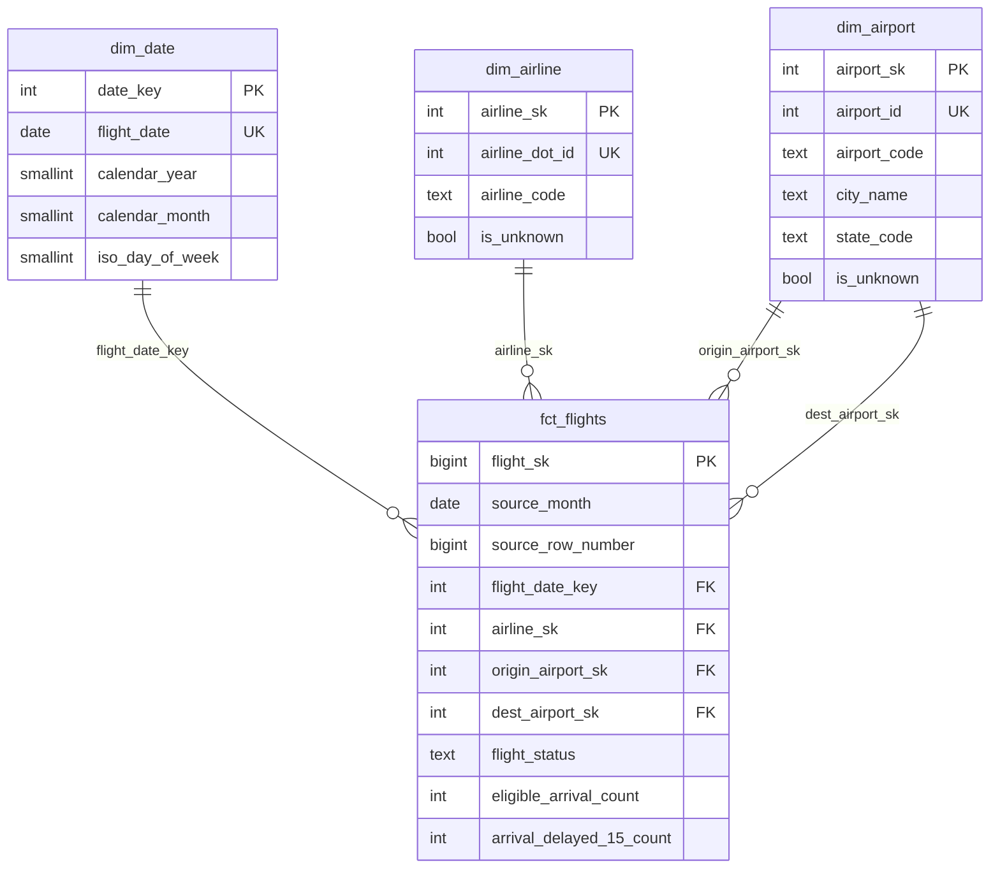

# M3.4 Star Schema ERD

The two airport foreign keys both point to `dim_airport`. The star is
logical: dbt relationships tests validate foreign keys; PostgreSQL dbt
tables have a unique index on their surrogate keys, not physical
`FOREIGN KEY` constraints. The source identity is
`(source_month, source_row_number)`, preserved in `fct_flights` for audit.
