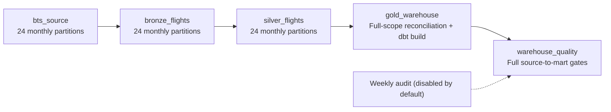

# Phase 7 - Dagster orchestration

## Scope and safety

Phase 7 prioritizes operating the existing historical BTS pipeline rather than creating another dashboard. The source contract remains January 2024 through December 2025 (24 immutable manifest entries). NOAA weather integration, a second risk dashboard, and delay-propagation analysis are optional future enhancements, not prerequisites.

The Dagster environment is separate from the existing ETL virtual environment. Dagster coordinates the existing CLIs; those CLIs retain ownership of checksum checks, idempotency, database transactions and audit records. It does not force recovery, replace partitions, download unapproved source months, refresh Power BI, or migrate the accepted semantic model.

## Asset graph



| Job | Scope | Purpose |
| --- | --- | --- |
| `source_bronze_month` | One historical month | Verify local source ZIP and run Bronze ingestion |
| `ingest_flight_month` | One historical month | Source, Bronze and transactional Silver load |
| `rebuild_gold_and_validate` | All 24 months | Require successful Silver reconciliation, run dbt build, then quality gates |
| `audit_job` | All 24 months | Read-only warehouse quality audit |

Dagster stores materialization metadata (source checksum/size, step, scope, elapsed time, exit code) and logs the existing pipeline output. A failing CLI stops its downstream assets. Source verification and read-only audits allow one retry after 10 seconds; write steps do not auto-retry. Rerun a failed month only after inspecting its cause. Gold rebuild and quality checks are separate operations, not an atomic warehouse-wide publication.

## Setup (Windows PowerShell)

Run from the repository root. The existing Phase 2-4 dependencies must be installed in `.venv`; see the [reproduction guide](../reproduction.md).

```powershell
.\.venv\Scripts\python.exe -m venv data/tmp/dagster-venv
.\data\tmp\dagster-venv\Scripts\python.exe -m pip install -r requirements-phase7.txt
.\data\tmp\dagster-venv\Scripts\python.exe -m pip check

$env:DAGSTER_HOME = Join-Path (Get-Location).Path 'data/tmp/dagster-home'
New-Item -ItemType Directory -Force -Path $env:DAGSTER_HOME | Out-Null
Copy-Item orchestration/dagster.yaml (Join-Path $env:DAGSTER_HOME 'dagster.yaml')
.\data\tmp\dagster-venv\Scripts\dagster.exe dev -w orchestration/workspace.yaml --host 127.0.0.1 --port 3000
```

Open http://127.0.0.1:3000 locally. The separate environment and persistent local run storage are under the already ignored `data/tmp/` tree. Do not expose the local UI publicly. The instance configuration serializes queued Dagster-launched runs. Do not run the underlying CLIs manually or launch independent Dagster instances against the same warehouse while these jobs are active. If using a different ETL environment, set `FLIGHT_PIPELINE_PYTHON` to its absolute Python executable before starting Dagster.

## Operational procedure

1. Start Docker Desktop and run `docker compose up -d --wait postgres` from the repository root.
2. Check the raw source ZIPs and accepted manifest. If raw files are missing, use the existing Phase 1 download/recovery instructions; inspect hashes before ingestion.
3. In Dagster, select a month in `source_bronze_month` for a Bronze-only check, or `ingest_flight_month` for an end-to-end monthly load. Repeat or backfill the 24 supported partitions as needed; unchanged inputs use existing Bronze/Silver skip logic.
4. After all months have been loaded, launch `rebuild_gold_and_validate` once, not after each month. The full-scope Silver reconciliation blocks the build if the expected population is incomplete or inconsistent.
5. Launch `audit_job` for a read-only check. The weekly schedule (Monday 02:00 UTC) is stopped by default. Enable only when the warehouse and Dagster daemon will be available.
6. Inspect run logs and the quality-gate summary. A documented REVIEW is not a FAIL; investigate any newly unexpected source exception. Never bypass a failing validation to claim success.

Existing Gold tables are rebuilt by dbt, not incrementally merged. The historical schedule does not imply live data acquisition; no future months are silently added. Automatic restart of the local Dagster service, external alerts, and production-grade run storage are outside this initial milestone.

## Testing

```powershell
.\.venv\Scripts\python.exe -m pytest -q -p no:cacheprovider tests
.\.venv\Scripts\ruff.exe check --select E4,E7,E9,F,I src/phase7 tests/test_phase7_orchestration.py
.\data\tmp\dagster-venv\Scripts\python.exe -m pytest -q tests/test_phase7_orchestration.py
```

The separate orchestration CI workflow installs Dagster and runs the contract/graph tests without raw data or PostgreSQL. Tests with a simulated runner verify order and failure propagation, not database outcomes. For live evidence see the [M7.1-M7.3 validation record](validation.md).

## M7.3 evidence and isolated benchmark

The main instance has successfully materialized all 24 historical
monthly partitions. A separate PostgreSQL instance on port 5543
verified a clean January 2024 load, idempotent January rerun and a
new February load. See the [validation record](validation.md) for
run IDs, row reconciliation and measurements.

To repeat the Gold experiment with the existing isolated test workspace,
first confirm its database is flight_m73_test on port 5543, both months
are loaded, and dbt has built and compiled the two-month models there.
From the repository root:

```powershell
.\.venv\Scripts\python.exe -m src.phase7.benchmark_incremental
```

This script creates connection-local temporary tables only. It requires
the isolated workspace and refuses unexpected database names, ports or
baseline counts. It does not modify the production dbt models.
