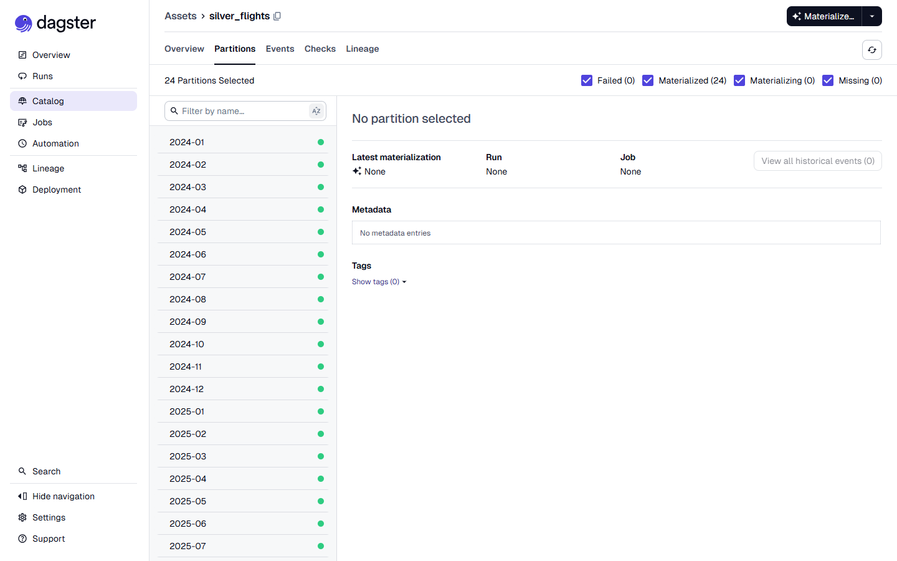

# Phase 7 monitoring runbook

The operating interface is Dagster, not an additional Power BI dashboard.
The main data scope remains January 2024 to December 2025. The weekly
audit is stopped by default; historical data does not require new daily
flight arrivals.

## Start and inspect

Follow the [orchestration runbook](README.md) to start PostgreSQL and the
main Dagster instance on loopback port 3000. Keep DAGSTER_HOME under the
ignored data/tmp/dagster-home directory. Do not run concurrent manual
writers against the warehouse.

From the repository root:

```powershell
.\data\tmp\dagster-venv\Scripts\python.exe -m src.phase7.observability
.\.venv\Scripts\python.exe -m src.phase7.health_check --component warehouse
.\data\tmp\dagster-venv\Scripts\python.exe -m src.phase7.health_check --component orchestration
```

The first command reads stored history from main, isolated ingestion,
recovery, scheduler and full Gold acceptance instances independently.
An uninitialized instance is reported as unavailable, not as a zero-run
success. Duration statistics cover terminal runs with valid timestamps.
Success rate is successful runs divided by terminal runs, including
canceled runs in the denominator. Expected injected M7.4 failures are
still counted as failures but separately identified. Row-event totals
come from the last valid summary per successful Bronze or Silver step;
reruns may count the same records again, and layer totals are not additive.
Partition coverage is distinct successful monthly ingestion runs, not a
replacement for database reconciliation.

The warehouse check validates all source ZIP hashes and Bronze Parquet
metadata/hashes, reconciles physical Silver rows and load audits, and
reuses the existing source-to-mart quality report inside a repeatable
read, read-only transaction. It records the latest successful Silver
load timestamp, not a live-flight freshness SLA. The orchestration
check reads current required daemon health and local HTTP response.
It does not enable schedules. A stopped daemon is not reported healthy
merely because an old heartbeat exists.

Exit code 0 means PASS or REVIEW; exit code 1 means FAIL. REVIEW retains
known data-quality exceptions rather than silently treating them as PASS.
For FAIL, inspect the affected check and actual Dagster/SQL logs locally;
the summary intentionally omits raw exceptions and credentials.
A health report is a point-in-time snapshot, not continuous monitoring
or an external alerting service.

## Operational evidence

Actual main-instance screenshots captured locally on 26 November 2026.
The main Dagster Gold assets have not been materialized there; the
warehouse existed before Dagster and full Gold acceptance is performed
in a separate instance to preserve the accepted report.

| View | Evidence |
| --- | --- |
| Grouped asset lineage | [Screenshot](screenshots/asset-lineage.png) |
| Run and backfill history | [Screenshot](screenshots/run-history.png) |
| Silver partitions: 24 materialized, 0 failed/missing | [Screenshot](screenshots/silver-partitions.png) |
| Weekly audit schedule stopped | [Screenshot](screenshots/automation.png) |



The main history had 25 successful runs (24 ingestion, one audit),
median duration 6.861 seconds, maximum 103.040 seconds, two successful
backfills, no failed runs and 14,080,680 skipped row-events per ingestion
layer. The separate M7.3 instance had three successful runs. The
recovery instance had two expected failures, two successes and one
retry; the scheduler instance had one successful scheduled run.

On the main warehouse, the live health check verified 24 source ZIPs,
24 Bronze partitions and 14,080,680 Silver/Gold flights. Quality status
was REVIEW (6 PASS, 2 documented REVIEW, 0 FAIL). HTTP 200 and all six
required Dagster daemons were healthy. These are observed local results,
not an uptime guarantee.

## Full Gold acceptance isolation

Use a new database named flight_m75_acceptance on the existing isolated
PostgreSQL instance (loopback port 5543). Never overwrite flight_warehouse
or flight_m73_test. Make a consistent pg_dump of only the silver and audit
schemas from the main database, with no owner/privilege restoration;
restore it into the newly created acceptance database. Confirm the
container identity and ports before executing any database operations.
The dump, credentials, cloned workspace and run history remain outside Git.

Prepare data/tmp/m75-gold with the tracked src, dbt, docs and sql trees
from the current Git revision, the full Bronze ingestion manifest at its
original relative path, and a local .env using the isolated database
credentials and acceptance database name. Initialize a dedicated
dagster-home directory with orchestration/dagster.yaml. The Gold job only
needs the Bronze manifest, not a duplicate set of raw ZIP or Parquet files.

Run from the main repository root only after the restore succeeds:

```powershell
.\data\tmp\dagster-venv\Scripts\python.exe -m src.phase7.gold_acceptance
```

The wrapper refuses the main and M7.3 database names/ports. It executes
the real existing rebuild_gold_and_validate job in a separate instance:
Silver reconciliation, dbt build and data-quality gates. Check the
actual run result and logs, and reconcile the main warehouse afterward.
The wrapper is opt-in; it is not a recurring production job.
