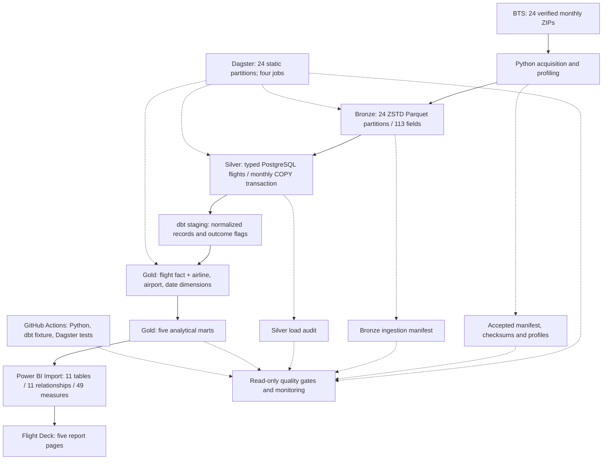
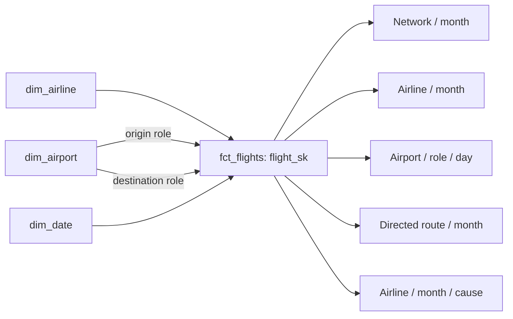

# M8.4 - Final system architecture

Flight Operations Intelligence is a local-first analytical warehouse for
the fixed January 2024 through December 2025 U.S. BTS reporting-carrier
flight population. The implemented data path is batch processing,
not real-time streaming or predictive risk scoring.

## Implemented data flow

Solid arrows show data flow. Dashed arrows show control, validation or
metadata. The scheduler is stopped by default. The full Gold job
requires all 24 Silver months and executes the existing dbt build
before warehouse quality gates. Monthly ingestion and Gold rebuilding
are deliberately separate. Dagster does not download additional months
or refresh Power BI. PostgreSQL is exposed on loopback only; local
credentials, runtime logs and raw data are excluded from Git.

## Data contracts and lineage

| Layer | Grain and contract | Accepted population |
| --- | --- | ---: |
| Source ZIP | One official monthly extract; file SHA-256 | 24 files |
| Bronze | One physical source row; source file, hash, month metadata and row number | 14,080,680 rows |
| Silver | One typed source observation; unique source month and source row number; monthly load audit | 14,080,680 rows |
| Staging | Same population; normalized outcomes and KPI flags | 14,080,680 rows |
| Gold fact | One physical source observation; stable surrogate flight key | 14,080,680 rows |
| Gold dimensions | Airline, airport and date, with Unknown members where applicable | 16 / 359 / 731 |
| Gold marts | Five distinct aggregate grains | See below |

The source lineage persists in Bronze, Silver and Gold fact. The
surrogate key is YYYYMM * 10,000,000 + source_row_number, not an
assumption that carrier, flight number and date form a unique business
key. The audit tracks month, source hash, Parquet hash and Bronze/Silver
counts. Mart-level traceability uses aggregate grain, keys, tested
reconciliation and the corresponding fact; aggregated rows do not
retain individual source row identifiers.

See [source contracts](../phase1/2024_2025/data_dictionary.md),
[Bronze schema](../phase2/bronze_schema.md),
[Silver pipeline](../phase3/m32_silver_pipeline.md),
[warehouse ERD](../phase3/m34_erd.md) and
[dimensional design](../phase3/m34_dimensional_model.md).

## Gold model and semantic boundaries

| Gold mart | Grain | Accepted rows |
| --- | --- | ---: |
| mart_network_monthly | source_month | 24 |
| mart_airline_monthly | airline_sk, source_month | 348 |
| mart_airport_daily | airport_sk, airport_role, flight_date | 481,262 |
| mart_route_monthly | origin_airport_sk, dest_airport_sk, source_month | 139,287 |
| mart_delay_causes | airline_sk, source_month, cause_type | 1,740 |

Power BI imports the five marts and six semantic dimensions: month,
date, airline, airport, origin airport and destination airport. The
two airport role tables are separate semantic views of the airport
dimension. The flight-level fact is not imported as a 14-million-row
semantic table. The month relationship filters each of the five marts;
airline filters airline and cause marts; airport and date filter the
airport/day mart; origin and destination filter the directed-route
mart. See the [semantic model](../phase5/m52_semantic_model.md),
[KPI mapping](../phase3/m35_kpi_mapping.md) and
[report acceptance](../phase5/m55_acceptance.md).

Use additive numerator and denominator counts before calculating
rates. Airport origin and destination populations each represent the
network; summing both roles doubles scheduled counts. Delay cause
minutes are reported attributions, not unique delayed flights or
causal predictions.

## Operational boundaries and evidence

| Boundary | Implemented | Verified evidence |
| --- | --- | --- |
| Source and Bronze | Immutable manifest, checksum checks, skip/recovery | [Phase 2](../phase2/README.md) |
| Silver | Monthly transaction, advisory lock, audit | [Silver validation](../phase3/m32_validation.md) |
| Gold | dbt table rebuild and 65 data tests | [Phase 7 acceptance](../phase7/acceptance.md) |
| Data quality | Full scope 6 PASS, 2 known REVIEW, 0 FAIL | [Phase 4](../phase4/validation.md) |
| Orchestration | Four jobs, 24 partitions, recovery and scheduling evidence | [Runbook](../phase7/README.md) |
| Analytics | Single canonical PBIP and five accepted pages | [Power BI](../phase5/README.md) |
| Performance | Repeatable read-only and isolated experiments | [Phase 8](README.md) |

The full-population Gold job passed in a separate acceptance database;
the main warehouse was not rebuilt for that experiment. No hosted
Dagster deployment, streaming ingestion, NOAA integration, second risk
dashboard, production incremental Gold migration or Azure Pipelines
execution is claimed. GitHub Actions is the verified automated CI;
GitHub and Azure DevOps are synchronized Git remotes.

See [engineering decisions](engineering_decisions.md) and
[clean-checkout reproduction](clean_reproduction.md).
